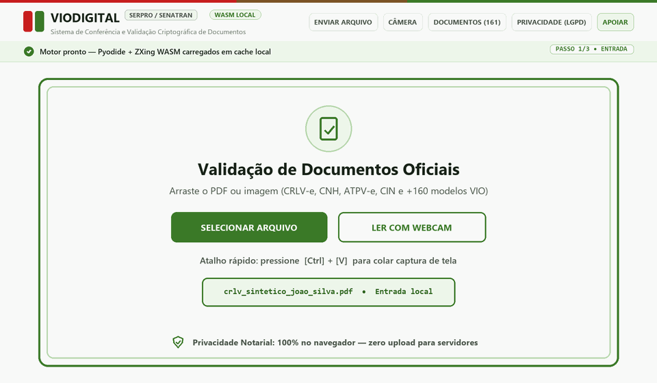
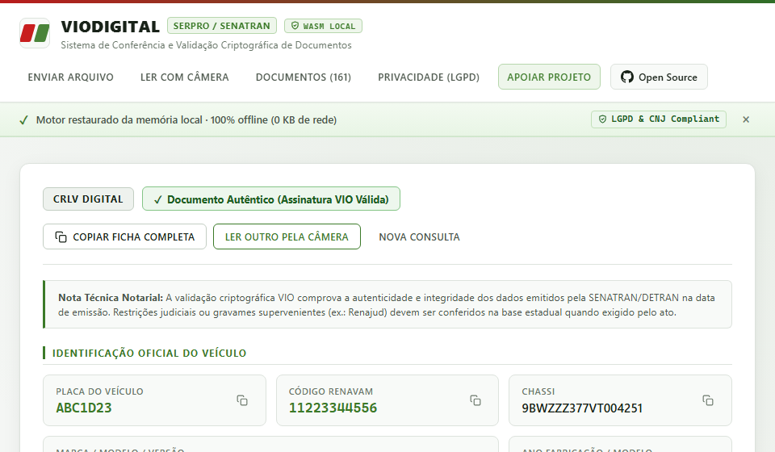
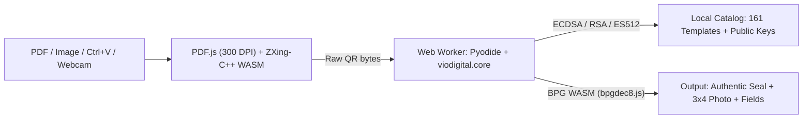
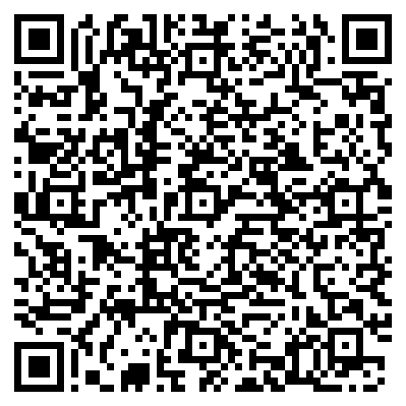

[🇧🇷 Português](README.md) | 🇺🇸 English

# VioDigital — Offline Cryptographic Verifier & Decoder for Brazilian Official Documents (Serpro / VIO & CIN)

> **100% free, offline, and open-source** cryptographic verifier and decoder for Brazilian government QR-coded documents (**CRLV-e, CNH, ATPV-e, CIN / National ID, Navy TIE, Army CRAF, and 160+ Serpro/VIO templates**) running directly in the browser via WebAssembly — zero data ever leaves your device.

[](https://github.com/Kauerc10/VioDigital/actions/workflows/ci.yml)
[](LICENSE)
[](https://www.python.org/)
[](https://github.com/Kauerc10/VioDigital/releases)
[](https://vioweb.vercel.app)
[](docs/adr/0001-offline-cryptographic-validation.md)

**Try it live in your browser (zero install):** [**https://vioweb.vercel.app**](https://vioweb.vercel.app)

> [!NOTE]
> **Legal Disclaimer & Non-Affiliation:** **VioDigital** is an independent, community-driven open-source project. It has no affiliation, endorsement, or official link with Serpro, SENATRAN, DETRANs, ONR, or any Brazilian issuing government agency. "VIO" is a registered trademark of its respective owners. Read our [Privacy & LGPD Compliance Policy](https://vioweb.vercel.app/privacidade).

---

## Visual Demo





> *Privacy Note (LGPD): All screenshots and animations exclusively use **synthetic/fictitious test documents** generated by our test suite (`JOAO DA SILVA`, license plate `ABC1D23`, RENAVAM `01122334455`). Zero real citizen PII is ever exposed.*

---

## Why VioDigital Exists (From a Notary Office to the Community)

In Brazilian notary and registry offices (*cartórios*), clerks verify dozens of official vehicle documents (**CRLV-e**, **ATPV-e**) and government IDs (**CNH driver's license**, **CIN / National ID**, **Professional IDs**) every single day.

Even though every one of these documents carries an official cryptographic QR Code issued by **Serpro/VIO** or **ICP-Brasil/ONR**, desktop workers faced two constant roadblocks:

1. The official government **Vio** app is mobile-only, forcing clerks to pull out their personal smartphones at the counter and manually retype fields from a tiny screen into desktop notarial software.
2. Existing web or desktop alternatives were **closed-source and paid** (charging monthly subscriptions or per-document fees) while uploading sensitive citizen PII (tax IDs, vehicle plates, chassis numbers, biometric photos) to third-party servers.

**VioDigital** was born directly inside a notary office to solve that daily friction with a **fast, clean, 100% free, open-source, desktop-first** tool: paste a screenshot (`Ctrl+V`), drag and drop a PDF from WhatsApp Web, or point a physical document at a PC webcam — and get cryptographically verified fields ready to copy in one click, strictly in local browser memory.

---

## Key Features

* **Desktop-First Input Methods:**
  * **Drag & Drop:** Direct support for **PDF** files (rendered locally at 300 DPI) and images (**PNG, JPEG, WebP**).
  * **Instant Clipboard Paste (`Ctrl + V`):** Paste screenshots directly from WhatsApp Web, e-mail, or PDFs without saving temporary files to disk.
  * **Webcam Optical Scanner:** Scan printed documents or smartphone screens via PC webcam with focus/zoom controls, sharp-frame burst capture, and optical enhancement (`camera-quality.js`).
* **Offline Cryptographic Validation (Serpro/VIO & ICP-Brasil):**
  * Unpacks VIO binary envelopes (**versions 2, 4, 5, and 6** — **6-bit, 7-bit, and BasE91** encodings) as well as **JWS ES512** tokens used in Brazil's **CIN (National Civil ID)**.
  * Mathematically verifies **asymmetric digital signatures (ECDSA / RSA)** against the bundled catalog of official government public certificates.
* **In-Browser Biometric Photo Decoding:**
  * Natively decodes **BPG (*Better Portable Graphics*)** biometric portrait photos embedded inside CNH and functional ID QR Codes to HTML5 Canvas via WebAssembly (`bpgdec8.js`).
* **Notarial Productivity:**
  * Auto-formatted masks (Mercosul/legacy vehicle plates, CPF, CNPJ, RENAVAM), per-field copy buttons, and a **"Copy Full Record"** action tailored for notarial systems.
* **Resilient Multi-QR Pipeline:**
  * When a page contains multiple QR codes (e.g., a court digital seal or a tax payment PIX QR alongside the VIO/CIN QR), the scanner automatically prioritizes the cryptographic document envelope.

---

## Quick Start (Web, Python/CLI & Docker)

### Option 1 — Browser / PWA (Zero Installation)

Open [**https://vioweb.vercel.app**](https://vioweb.vercel.app) in any modern browser (Chrome, Edge, Firefox, Safari). After the initial runtime download (~19 MB Pyodide + WASM bundle), the Service Worker caches everything locally so validation keeps working **completely offline**.

### Option 2 — Python (`pip` / Local Server / CLI / Library)

Prerequisite: **Python 3.12+**.

```bash
# 1. Clone the repository
git clone https://github.com/Kauerc10/VioDigital.git
cd VioDigital

# 2. Install in editable mode with local web server and computer vision extras
pip install -e ".[server,vision]"

# 3. Launch the local web interface and API
python -m viodigital
```

Open **`http://127.0.0.1:8000`** in your browser.

#### CLI Usage

```bash
# Parse, verify signature, and print formatted fields
viodigital document.pdf

# Output structured JSON and extract embedded BPG biometric photo as PNG
viodigital cnh.pdf --json --save-photo photo.png

# Useful flags: --dpi 300 | --cin-env PROD|HML|TST|* | --no-verify | --include-raw
```

#### Python Library Usage

```python
from viodigital.core import DigitalDocumentChecker

checker = DigitalDocumentChecker()
result = checker.parse_file("document.pdf")

print(result.document_type, result.is_authentic, result.is_valid)
print(result.fields)
```

### Option 3 — Docker / Self-Hosted (Intranets & Air-Gapped Networks)

Built for notary office IT teams, dispatchers, and privacy-strict self-hosters:

```bash
git clone https://github.com/Kauerc10/VioDigital.git
cd VioDigital
docker compose up --build
```

Or pull the prebuilt image from GitHub Container Registry (GHCR):

```bash
docker run -d -p 8000:8000 --name viodigital ghcr.io/kauerc10/viodigital:latest
```

* Serves the full app and local API on **`http://127.0.0.1:8000`** with healthcheck at **`GET /api/health`**.
* Runs as a non-root user with prebuilt static assets and **zero outbound network calls** during validation.

### Running Tests & Lint

```bash
pip install -e ".[dev]"
ruff check .
pytest
```

---

## Architecture: 100% In-Browser Validation via WebAssembly

A single Python core (`viodigital.core`) powers both the browser WebAssembly runtime (**Pyodide**) and the native CLI / **FastAPI** local server, preventing parser drift across environments:



### Deterministic Wheel Rebuild & Hybrid Offline Caching

* **Automatic WASM Wheel Rebuild (`.wheel_hash`):** Starting `python -m viodigital` or running `python src/viodigital/build_static.py` hashes `src/viodigital/core`, `src/vioweb`, and `pyproject.toml` with SHA-256 against `.wheel_hash`; if anything changes, the pure-Python `viodigital-*.whl` loaded by Pyodide is rebuilt locally in milliseconds.
* **Hybrid Service Worker (`sw.js`):** Heavy immutable vendor assets in `/static/vendor/` (`Pyodide`, `ZXing`, `PDF.js`, icons) use **Cache-First** for instant offline startup, while the `.whl` engine, JS, CSS, and HTML pages use **Network-First with offline fallback** and build-hash invalidation (`/api/version`).

---

## Privacy (LGPD) & Verifiable Zero-Network Audit

On [**`https://vioweb.vercel.app`**](https://vioweb.vercel.app), **no document, CPF, vehicle plate, or biometric photo ever leaves your computer**. Anyone can verify this claim in 30 seconds:

1. Open [**https://vioweb.vercel.app**](https://vioweb.vercel.app) and wait for the **`WASM LOCAL`** badge in the header.
2. Open Browser DevTools (`F12`) → **Network** tab → enable **Preserve log**.
3. Optionally toggle **Offline** mode in DevTools (or disconnect Wi-Fi).
4. Paste (`Ctrl+V`) or drop any PDF/image: observe the Network tab — **zero outbound HTTP requests** occur while decoding or verifying the document.
5. Inspect the active **`Content-Security-Policy`** header returned by the server (`vercel.json` / `app.py`):

```http
Content-Security-Policy: default-src 'self'; connect-src 'self'; script-src 'self' 'unsafe-inline' 'wasm-unsafe-eval' blob:; worker-src 'self' blob:; img-src 'self' data: blob:; style-src 'self' 'unsafe-inline'; font-src 'self'; manifest-src 'self';
```

* **`connect-src 'self'`:** The browser actively blocks any attempt to `fetch`, `XHR`, or open a `WebSocket` to external domains.
* **Zero `'unsafe-eval'` & zero external fonts:** Only `'wasm-unsafe-eval'` is permitted for WebAssembly execution, paired with `Referrer-Policy: no-referrer` and `X-Frame-Options: DENY`.
* Continuously enforced in CI via Playwright E2E tests in [`tests/test_e2e_privacy.py`](tests/test_e2e_privacy.py). See [Privacy & LGPD Policy](https://vioweb.vercel.app/privacidade) and [ADR 0003](docs/adr/0003-browser-wasm-pyodide-validation.md).

---

## Supported Documents (161 Official VIO Templates + CIN)

The engine bundles the official **161 Serpro/VIO templates** (`templates.json`) plus the public keys for Brazil's **National Identity Card (CIN)**. Browse the [online searchable catalog](https://vioweb.vercel.app/documentos):

| Category | Supported Official Documents |
| :--- | :--- |
| **Traffic & Vehicles (SENATRAN / DETRAN / PRF)** | • **CRLV-e Digital** Vehicle Registration (Templates `10`, `12`, `62`, `70`)<br>• **CRV-e RENAVE** Dealer Title (Template `24`)<br>• **CNH Digital & Physical** Driver's License with Biometric Photo (Templates `2`, `4`, `83`)<br>• **ATPV-e** Electronic Vehicle Sale Authorization (Template `43`)<br>• **Mercosul License Plate** (`11`, `17`), **Parking Permits** (`95`, `162`), **PRF Accident Reports** (`50`, `51`), **Instructor ID** (`237`) |
| **National Civil Identification** | • **CIN — Carteira de Identidade Nacional / New National ID** (JWS `ES512` ICP-Brasil)<br>• **State Digital RG** (`91`, `92`) and **DNI — National Identity Document** (`8`, `9`, `73`)<br>• **Digital CPF** (`25`) and **MEC Student ID** (`23`, `236`) |
| **Brazilian Navy / Maritime (DPC)** | • **TIE — Vessel Registration Title PF & PJ** (Templates `116`, `118`)<br>• **CHA — Amateur Skipper & Personal Watercraft License** (`97`, `104`, `110`)<br>• **DPC Maritime Certificates** (`141`, `151`, `167`) |
| **Army, Firearms (SFPC) & Public Security** | • **CRAF — Firearm Registration Certificate** (`52`) and **Transit Guide** (`53`)<br>• **Military & Law Enforcement IDs** (Army `108`, Air Force `79`, Fire Dept `102`/`122`, Military Police `107`, Legislative Police `128`/`129`, Municipal Guard `183`/`191`) |
| **Professional Councils & Functional IDs** | • **CREA** Engineering (PR, RS, RN, SE, CE, TO, AL), **CRA** Administration (SC, SP, RS, PR, ES, BA), **CREF**, **CREFITO**, **CFN**, **CONFERP**<br>• **Judiciary, Public Prosecutors & Public Defenders** (MPRS, MPPE, MPMG, MPTO, DPE-RS, DPE-AC, DPE-MA, DP-AM, TJAP, Senate) |
| **Health, Labor & Federal Treasury** | • **Digital Medical Certificate — Ministry of Health** (`31`), **CAT — Work Accident Report** (`229`), **CAUC / SICONFI / CAPAG Extracts** |

---

## Fundamental Notarial Legal Distinction

When using **VioDigital** in notarial or compliance workflows, keep this legal and technical boundary (detailed in [`CONTEXT.md`](CONTEXT.md)) explicit:

1. **Document Authenticity (Guaranteed by VioDigital):**
   * Mathematically proves that the PDF, image, or printed QR Code was genuinely signed by SERPRO/SENATRAN/ONR and that its text fields and biometric photo have not been altered since issuance.
2. **Real-Time Registry Status (Requires Official DETRAN / RENAVAM Lookup):**
   * The QR Code reflects the vehicle or license state **at the exact time of issuance**. Subsequent judicial or administrative liens (e.g., Renajud blocks, new fiduciary liens, sale notifications, license suspensions) are not encoded inside the offline QR Code and still require an online registry query when mandated by law.

---

## Repository Structure & Documentation

```text
VioDigital/
├── src/viodigital/
│   ├── api/                 # FastAPI server, CSP/Cache headers, and REST endpoints (/api/health, /api/documents/verify)
│   ├── core/                # VIO/CIN cryptographic engine, multi-QR reader, CLI, and certificate store
│   │   ├── data/            # Official templates catalog and ICP-Brasil/SENATRAN public keys
│   │   ├── documents/       # Typed document handlers (CRLV, CNH, ATPV, CIN, RG, DNI, Generic)
│   │   └── formats/         # Binary envelope unpackers v2, v4, v5, v6 (6-bit, 7-bit, BasE91) & JWS
│   └── web/                 # Static frontend, PWA Service Worker, Webcam scanner, and BPG WASM decoder
├── docs/
│   ├── adr/                 # Architecture Decision Records (ADRs 0001–0003)
│   ├── assets/              # Synthetic visual demos (GIF and screenshots)
│   ├── launch-playbook.md   # Community launch kit & rollout schedule
│   └── vio-reverse-engineering.md  # Technical specification of the VIO binary protocol
├── tests/                   # Pytest suite (unit, API, static build, CSP, and Playwright E2E)
├── Dockerfile               # Multi-stage non-root container build
├── docker-compose.yml       # Single-command offline self-hosting setup
├── CONTEXT.md               # Domain glossary and operational assumptions
├── CONTRIBUTING.md          # Contribution guide and LGPD Privacy Golden Rules
├── CODE_OF_CONDUCT.md       # Contributor Covenant Code of Conduct
├── SECURITY.md              # Responsible vulnerability disclosure policy
├── CHANGELOG.md             # Release changelog
└── LICENSE                  # MIT License
```

* [Domain Glossary & Notarial Concepts (`CONTEXT.md`)](CONTEXT.md)
* [VIO Protocol Reverse Engineering & Spec (`docs/vio-reverse-engineering.md`)](docs/vio-reverse-engineering.md)
* [ADR 0001: Local Offline Cryptographic Validation](docs/adr/0001-offline-cryptographic-validation.md)
* [ADR 0002: Decoder & Web Interface Architecture](docs/adr/0002-crlv-and-cnh-decoding-architecture.md)
* [ADR 0003: 100% In-Browser Validation via WebAssembly (Pyodide)](docs/adr/0003-browser-wasm-pyodide-validation.md)
* [Third-Party Software Notices (`THIRD_PARTY_NOTICES.md`)](THIRD_PARTY_NOTICES.md)

---

## Contributing

Contributions are welcome! Please read our [**Contributing Guide (`CONTRIBUTING.md`)**](CONTRIBUTING.md) before opening a Pull Request.

* **Great first issues (`good first issue`):** implementing typed `DocumentHandler` subclasses for additional document categories (Navy TIE/CHA, Army CRAF/Transit Guide, Professional Councils), optical QR preprocessing improvements, and desktop UX/accessibility shortcuts.
* **Privacy Golden Rule (LGPD):** never commit real citizen documents in commits, issues, or PRs — always use synthetic test fixtures.
* **Community & Security:** see our [Code of Conduct (`CODE_OF_CONDUCT.md`)](CODE_OF_CONDUCT.md), [Security Policy (`SECURITY.md`)](SECURITY.md), and [Changelog (`CHANGELOG.md`)](CHANGELOG.md).

---

## Credits & Acknowledgments

* The core Python VIO/CIN cryptographic decoding foundation started from the open-source library [**`digital-document-checker`**](https://github.com/helviojunior/digital-document-checker), created by **Helvio Junior (`@helviojunior` / `M4v3r1ck`)** under the MIT License.
* Building on that foundation, **VioDigital** added dedicated handlers for **CRLV-e**, **CRV-e RENAVE (Template 24)**, and **ATPV-e (Template 43)**, a resilient **Multi-QR** computer-vision pipeline, **BPG biometric rendering in HTML5 Canvas via WebAssembly (`bpgdec8.js`)**, **Webcam scanning** with optical enhancement, **`Ctrl+V` clipboard paste**, and full browser execution via **Pyodide + ZXing-C++ WASM + PDF.js**.

---

## Support the Project (Keep VioDigital Free)

**VioDigital** was created to remain **free, open, and accessible** for every notary clerk, dispatcher, developer, and Brazilian citizen — without per-document fees.

If this project saves you time or infrastructure cost, please consider supporting it:

* ⭐ **Star** this repository on GitHub and share it with colleagues and fellow developers!
* 💬 Report bugs, request document handlers, or share ideas via [GitHub Issues](https://github.com/Kauerc10/VioDigital/issues).
* ☕ **Voluntary support via PIX (Brazil):**

<div align="center">
  <br>
  <strong>Random PIX Key:</strong> <code>84afcca1-eea6-4a15-9adf-581b37fb5897</code><br>
  <em>Beneficiary: Kaue Ruon Cardoso · São Paulo, Brazil</em>
</div>

<details>
<summary>📋 Click to view <strong>Pix Copia e Cola</strong> payload</summary>

```text
00020126720014br.gov.bcb.pix013684afcca1-eea6-4a15-9adf-581b37fb58970210VIODIGITAL5204000053039865802BR5917KAUE RUON CARDOSO6009Sao Paulo62260522ApoioProjetoVioDigital6304383F
```
</details>

Or visit the [support page on VioDigital](https://vioweb.vercel.app/apoiar).

---

## License

Distributed under the **MIT License**. See [`LICENSE`](LICENSE) for details.
