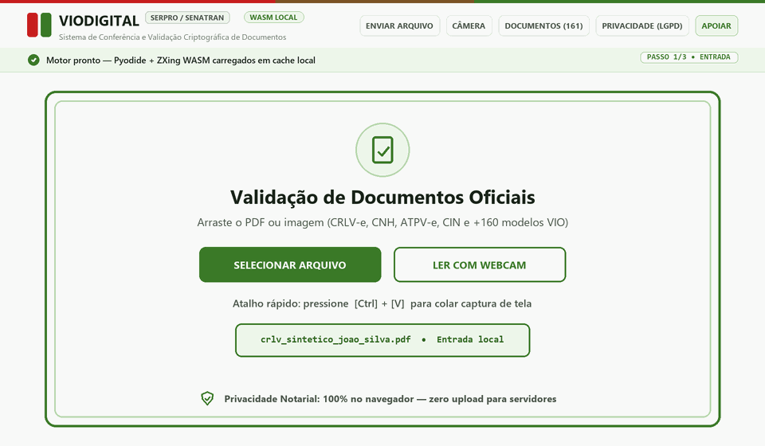
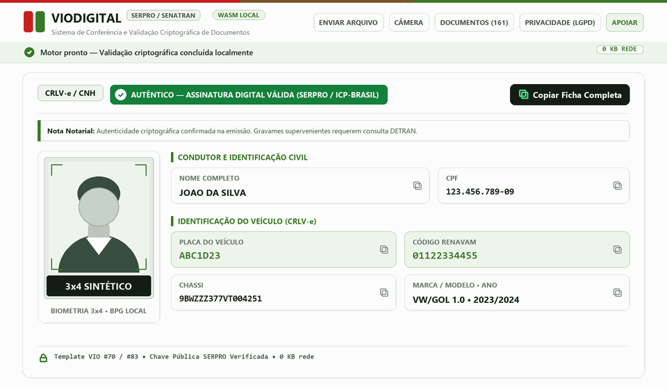
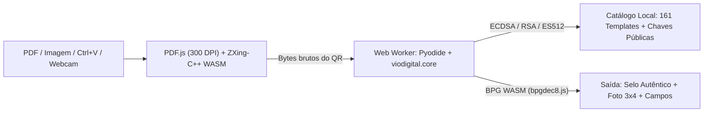
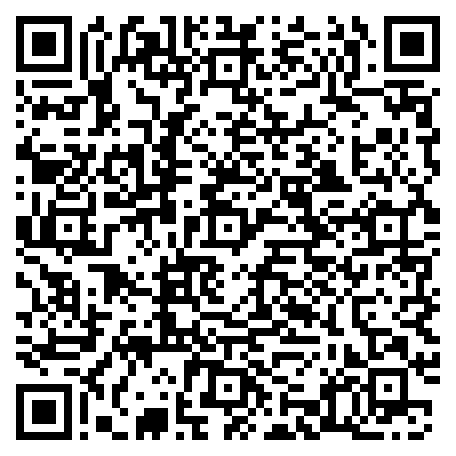

🇧🇷 Português | [🇺🇸 English](README.en.md)

# VioDigital — Validação e Decodificação Criptográfica Offline de Documentos Oficiais (Serpro / VIO & CIN)

> Verificador e decodificador criptográfico **100% gratuito, offline e Open Source** de documentos oficiais brasileiros (**CRLV-e, CNH, ATPV-e, CIN / Novo RG, TIE Marinha, CRAF e +160 templates VIO**) direto no navegador via WebAssembly — zero dados enviados a servidores.

[](https://github.com/Kauerc10/VioDigital/actions/workflows/ci.yml)
[](LICENSE)
[](https://www.python.org/)
[](https://github.com/Kauerc10/VioDigital/releases)
[](https://viodigital.com.br)
[](docs/adr/0001-offline-cryptographic-validation.md)

**Acesse gratuitamente no navegador (sem instalação):** [**https://viodigital.com.br**](https://viodigital.com.br)

> [!NOTE]
> **Aviso Legal e Não-Afiliação Institucional:** O **VioDigital** é um software livre e independente desenvolvido para a comunidade. Não possui qualquer vínculo, afiliação, representação ou endosso por parte do Serpro, SENATRAN, DETRANs, ONR ou órgãos públicos emissores. "VIO" é marca registrada de seus respectivos titulares. Consulte nossa [Política de Privacidade e Conformidade LGPD](https://viodigital.com.br/privacidade).

---

## Demonstração Visual





> *Nota LGPD: Todas as capturas e animações utilizam exclusivamente **documentos sintéticos/fictícios** gerados pela suíte de testes (`JOAO DA SILVA`, placa `ABC1D23`, RENAVAM `01122334455`), sem exposição de dados de cidadãos reais.*

---

## Por que o VioDigital nasceu? (De um Cartório para a Comunidade)

Na rotina diária de um **cartório de notas e registros**, escreventes e atendentes conferem dezenas de documentos veiculares (**CRLV-e**, **ATPV-e**) e de identificação (**CNH Digital e Física**, **CIN / Novo RG**, **Carteiras Funcionais**) todos os dias.

Apesar de todos esses documentos possuírem o **QR Code criptográfico oficial do Serpro/VIO** ou da **ICP-Brasil/ONR**, quem trabalha no computador enfrentava sempre o mesmo atrito:

1. O aplicativo oficial **Vio** existe apenas para celular, obrigando colaboradores a usarem seus próprios smartphones pessoais no balcão e digitarem manualmente no sistema notarial todos os dados lidos na telinha.
2. As alternativas existentes para computador ou web eram **fechadas e pagas** (cobrando mensalidades caras ou taxas por cada documento consultado), além de exigirem o envio de documentos sensíveis de clientes (CPF, placa, chassi, fotografia biométrica) para servidores de terceiros.

O **VioDigital** nasceu diretamente dessa necessidade real dentro do cartório: construir uma ferramenta **rápida, limpa, profissional, 100% gratuita e de código aberto**, onde o colaborador possa simplesmente **colar um print (`Ctrl+V`)**, **arrastar um PDF recebido no WhatsApp Web** ou **apontar o documento físico para a webcam do PC** e ter todos os dados validados criptograficamente em memória local e prontos para copiar em um clique.

---

## Principais Funcionalidades

* **Múltiplas Formas de Entrada no Desktop:**
  * **Arraste e Solte (`Drag & Drop`):** Suporte direto a arquivos **PDF** (rasterizados localmente a 300 DPI) e imagens (**PNG, JPEG, WebP**).
  * **Colagem Instantânea (`Ctrl + V`):** Cole capturas de tela (prints de WhatsApp Web, e-mail ou PDF) em qualquer lugar da página sem salvar arquivos no disco.
  * **Leitor Óptico via Webcam:** Escaneie documentos físicos impressos ou apresentados na tela do celular do cliente diretamente pela webcam do computador, com controle de foco/zoom, rajada nítida e realce óptico (`camera-quality.js`).
* **Validação Criptográfica Offline (Padrão Serpro/VIO & ICP-Brasil):**
  * Desempacota envelopes binários VIO (**versões 2, 4, 5 e 6** — compactação em **6-bit, 7-bit e BasE91**) e tokens **JWS ES512** da **CIN (Carteira de Identidade Nacional)**.
  * Verifica matematicamente a **assinatura digital assimétrica (ECDSA / RSA)** contra o repositório local de certificados públicos oficiais embarcado no sistema.
* **Renderização de Fotografia Biométrica no Navegador:**
  * Decodifica nativamente fotografias biométricas comprimidas no formato **BPG (*Better Portable Graphics*)** utilizado pelo Serpro dentro do QR Code da CNH e carteiras funcionais via WebAssembly (`bpgdec8.js`).
* **Produtividade Notarial:**
  * Formatação automática de máscaras (**Placa Mercosul/Antiga, CPF, CNPJ, RENAVAM**), botão de cópia individual por campo e botão **"Copiar Ficha Completa"** para colagem direta em sistemas notariais.
* **Pipeline Multi-QR Resiliente:**
  * Quando uma página possui múltiplos QR Codes (ex.: Selo Digital do Tribunal de Justiça/Cartório + QR Code VIO da ATPV-e/CRLV-e, ou QR Code PIX de taxa do Detran), o motor prioriza automaticamente o envelope criptográfico VIO/CIN.

---

## Quick Start (Web, Python/CLI e Docker)

### Opção 1 — Navegador / PWA (Zero Instalação)

Acesse [**https://viodigital.com.br**](https://viodigital.com.br) diretamente em qualquer navegador moderno (Chrome, Edge, Firefox, Safari). Após o pré-carregamento inicial (~19 MB do runtime Pyodide/WASM), o Service Worker mantém tudo em cache local para operar **mesmo sem internet**.

### Opção 2 — Python (`pip` / Servidor Local / CLI / Biblioteca)

Pré-requisito: **Python 3.12+**.

```bash
# 1. Clone o repositório
git clone https://github.com/Kauerc10/VioDigital.git
cd VioDigital

# 2. Instale em modo editável com servidor web local e visão computacional
pip install -e ".[server,vision]"

# 3. Suba a interface web e API na sua máquina ou intranet do cartório
python -m viodigital
```

Acesse **`http://127.0.0.1:8000`** no navegador.

#### Uso via Linha de Comando (CLI)

```bash
# Validar e exibir campos formatados no terminal
viodigital documento.pdf

# Exportar JSON estruturado e extrair foto biométrica BPG como PNG
viodigital cnh.pdf --json --save-photo foto.png

# Opções úteis: --dpi 300 | --cin-env PROD|HML|TST|* | --no-verify | --include-raw
```

#### Uso como Biblioteca Python

```python
from viodigital.core import DigitalDocumentChecker

checker = DigitalDocumentChecker()
result = checker.parse_file("documento.pdf")

print(result.document_type, result.is_authentic, result.is_valid)
print(result.fields)
```

### Opção 3 — Docker / Self-Hosted (Intranet de Cartórios e Redes Air-Gapped)

Ideal para times de TI de cartórios, despachantes e ambientes corporativos com restrição de acesso externo:

```bash
git clone https://github.com/Kauerc10/VioDigital.git
cd VioDigital
docker compose up --build
```

Ou usando a imagem publicada no GitHub Container Registry (GHCR):

```bash
docker run -d -p 8000:8000 --name viodigital ghcr.io/kauerc10/viodigital:latest
```

* O serviço responde em **`http://127.0.0.1:8000`** com verificação de saúde em **`GET /api/health`**.
* Executa com usuário não-root, build estático embutido e **zero chamadas de rede externas** durante a validação.

### Executando os Testes e Lint

```bash
pip install -e ".[dev]"
ruff check .
pytest
```

---

## Arquitetura: Validação 100% no Navegador via WebAssembly

O mesmo núcleo em Python (`viodigital.core`) é compartilhado entre o modo navegador (WebAssembly via **Pyodide**), a CLI e o servidor **FastAPI** local, eliminando divergências entre parsers:



### Auto-Atualização Determinística e Cache Offline Híbrido

* **Recompilação Automática da Wheel WASM (`.wheel_hash`):** Ao iniciar `python -m viodigital` ou executar `python src/viodigital/build_static.py`, o hash SHA-256 de `src/viodigital/core`, `src/vioweb` e `pyproject.toml` é verificado contra `.wheel_hash`; havendo alteração, a wheel `viodigital-*.whl` é regenerada offline em milissegundos.
* **Service Worker Híbrido (`sw.js`):** Os runtimes imutáveis em `/static/vendor/` (`Pyodide`, `ZXing`, `PDF.js` e ícones) usam **Cache-First** para abertura instantânea e operação offline, enquanto a wheel `.whl`, JS, CSS e HTML usam **Network-First com fallback offline** e invalidação por hash de build (`/api/version`).

---

## Privacidade (LGPD) e Auditoria Zero-Network no Navegador

No VioDigital público (**`viodigital.com.br`**), **nenhum documento, CPF, placa, chassi ou foto sai do seu computador**. Você pode auditar essa garantia técnica em 30 segundos:

1. Acesse [**https://viodigital.com.br**](https://viodigital.com.br) e aguarde o selo **`WASM LOCAL`** aparecer no cabeçalho.
2. Abra o **DevTools** do navegador (`F12`) → aba **Rede (`Network`)** → marque **Preservar registro (`Preserve log`)**.
3. Opcionalmente, ative o modo **Offline** no DevTools ou desconecte a internet do computador.
4. Cole um print (`Ctrl+V`) ou arraste um PDF/imagem: confirme na aba Rede que **nenhuma requisição HTTP externa** é disparada durante toda a leitura e verificação.
5. Inspecione o cabeçalho **`Content-Security-Policy`** ativo nas respostas do site (`vercel.json` / `app.py`):

```http
Content-Security-Policy: default-src 'self'; connect-src 'self'; script-src 'self' 'unsafe-inline' 'wasm-unsafe-eval' blob:; worker-src 'self' blob:; img-src 'self' data: blob:; style-src 'self' 'unsafe-inline'; font-src 'self'; manifest-src 'self';
```

* **`connect-src 'self'`:** O navegador bloqueia ativamente qualquer tentativa de `fetch`, `XHR` ou `WebSocket` para domínios terceiros.
* **Zero `'unsafe-eval'` e zero fontes externas:** Apenas `'wasm-unsafe-eval'` para execução WebAssembly; combinado com `Referrer-Policy: no-referrer` e `X-Frame-Options: DENY`.
* Essa garantia é testada continuamente no CI por Playwright em [`tests/test_e2e_privacy.py`](tests/test_e2e_privacy.py). Veja mais em [Política de Privacidade e LGPD](https://viodigital.com.br/privacidade) e no [ADR 0003](docs/adr/0003-browser-wasm-pyodide-validation.md).

---

## Documentos Suportados (161 Templates Oficiais VIO + CIN)

O motor embarca o catálogo oficial de **161 templates do Serpro/VIO** (`templates.json`) e as chaves públicas da **Carteira de Identidade Nacional (CIN)**. Consulte também o [catálogo pesquisável online](https://viodigital.com.br/documentos):

| Categoria | Documentos Oficiais Suportados |
| :--- | :--- |
| **Trânsito e Veículos (SENATRAN / DETRAN / PRF)** | • **CRLV-e Digital** (Templates `10`, `12`, `62`, `70`)<br>• **CRV-e RENAVE** (Template `24`)<br>• **CNH Digital e Física** com Foto Biométrica BPG (Templates `2`, `4`, `83`)<br>• **ATPV-e — Autorização para Transferência de Propriedade** (Template `43`)<br>• **Placa Veicular Mercosul** (`11`, `17`), **Credencial de Estacionamento** (`95`, `162`), **Boletim de Acidente PRF** (`50`, `51`) e **Carteira de Instrutor** (`237`) |
| **Identificação Civil Nacional** | • **CIN — Carteira de Identidade Nacional / Novo RG** (JWS `ES512` ICP-Brasil)<br>• **RG Digital Estadual** (`91`, `92`) e **DNI — Documento Nacional de Identidade** (`8`, `9`, `73`)<br>• **CPF Digital** (`25`) e **Identidade Estudantil MEC** (`23`, `236`) |
| **Marinha do Brasil / Náutica (DPC)** | • **TIE — Título de Inscrição de Embarcação PF e PJ** (Templates `116`, `118`)<br>• **CHA — Carteira de Habilitação de Amador e Motonauta** (`97`, `104`, `110`)<br>• **Certificados Marítimos DPC** (`141`, `151`, `167`) |
| **Exército, Armas (SFPC) e Segurança Pública** | • **CRAF — Certificado de Registro de Arma de Fogo** (`52`) e **Guia de Tráfego** (`53`)<br>• **Identidades Militares e Policiais** (Exército `108`, FAB `79`, Bombeiros `102`/`122`, PM `107`, Polícia Legislativa `128`/`129`, GCM `183`/`191`) |
| **Conselhos Profissionais e Identidades Funcionais** | • **CREA** (PR, RS, RN, SE, CE, TO, AL), **CRA** (SC, SP, RS, PR, ES, BA), **CREF**, **CREFITO**, **CFN**, **CONFERP**<br>• **Magistrados, Ministério Público e Defensoria Pública** (MPRS, MPPE, MPMG, MPTO, DPE-RS, DPE-AC, DPE-MA, DP-AM, TJAP, Senado) |
| **Saúde, Trabalho e Administração Federal** | • **Atestado Médico Digital — Ministério da Saúde** (`31`), **CAT — Comunicação de Acidente de Trabalho** (`229`), **Extrato CAUC / SICONFI / CAPAG** |

---

## Distinção Notarial Fundamental

Ao utilizar o **VioDigital** em balcão de cartório ou conferência corporativa, é indispensável observar a separação jurídica e técnica descrita em [`CONTEXT.md`](CONTEXT.md):

1. **Autenticidade do Documento (Garantida pelo VioDigital):**
   * Comprova matematicamente que o PDF, imagem ou impresso foi legitimamente emitido e assinado pelo SERPRO/SENATRAN/ONR e que seus dados textuais e fotografia biométrica não sofreram adulteração desde a emissão.
2. **Situação Cadastral em Tempo Real (Exige Consulta DETRAN / RENAVAM):**
   * O QR Code reflete o estado do veículo ou habilitação **no instante da emissão**. Restrições supervenientes (bloqueio Renajud, nova alienação fiduciária, comunicação de venda ou suspensão de CNH posteriores) não constam no QR Code e continuam exigindo consulta online às bases oficiais quando requerido pelo ato notarial.

---

## Estrutura do Repositório e Documentação

```text
VioDigital/
├── src/viodigital/
│   ├── api/                 # Servidor FastAPI, headers CSP/Cache e endpoints (/api/health, /api/documents/verify)
│   ├── core/                # Motor criptográfico VIO/CIN, leitor multi-QR, CLI e catálogo de certificados
│   │   ├── data/            # Catálogo oficial de templates e chaves públicas ICP-Brasil/SENATRAN
│   │   ├── documents/       # Handlers tipados (CRLV, CNH, ATPV, CIN, RG, DNI, Generic)
│   │   └── formats/         # Desempacotadores binários v2, v4, v5, v6 (6-bit, 7-bit, BasE91) e JWS
│   └── web/                 # Interface web estática, Service Worker PWA, Scanner Webcam e BPG WASM
├── docs/
│   ├── adr/                 # Registros de Decisão de Arquitetura (ADRs 0001–0003)
│   ├── assets/              # Demonstrações visuais sintéticas (GIF e capturas de tela)
│   ├── launch-playbook.md   # Kit e cronograma de lançamento comunitário
│   └── vio-reverse-engineering.md  # Especificação técnica do protocolo binário VIO
├── tests/                   # Suíte Pytest (unitários, API, build estático, CSP e E2E Playwright)
├── Dockerfile               # Build container multi-estágio não-root
├── docker-compose.yml       # Subida em um comando para self-hosting offline
├── CONTEXT.md               # Glossário do domínio notarial e premissas operacionais
├── CONTRIBUTING.md          # Guia de contribuição e Regras de Ouro de Privacidade
├── CODE_OF_CONDUCT.md       # Código de Conduta (Contributor Covenant)
├── SECURITY.md              # Política de divulgação responsável de vulnerabilidades
├── CHANGELOG.md             # Histórico de versões
└── LICENSE                  # Licença MIT
```

* [Glossário do Domínio e Conceitos Notariais (`CONTEXT.md`)](CONTEXT.md)
* [Especificação Técnica do Padrão VIO (`docs/vio-reverse-engineering.md`)](docs/vio-reverse-engineering.md)
* [ADR 0001: Validação Criptográfica Offline Local](docs/adr/0001-offline-cryptographic-validation.md)
* [ADR 0002: Arquitetura do Decodificador e Interface Web](docs/adr/0002-crlv-and-cnh-decoding-architecture.md)
* [ADR 0003: Validação 100% no Navegador via WebAssembly (Pyodide)](docs/adr/0003-browser-wasm-pyodide-validation.md)
* [Avisos e Licenças de Terceiros (`THIRD_PARTY_NOTICES.md`)](THIRD_PARTY_NOTICES.md)

---

## Como Contribuir

Contribuições são muito bem-vindas! Leia o nosso [**Guia de Contribuição (`CONTRIBUTING.md`)**](CONTRIBUTING.md) antes de abrir um Pull Request.

* **Boas primeiras contribuições (`good first issue`):** criação de `DocumentHandler`s tipados para novas categorias (Marinha TIE/CHA, Exército CRAF/Guia, Conselhos Profissionais), melhorias ópticas para QR Codes desgastados e atalhos de produtividade notarial.
* **Regra de Ouro de Privacidade (LGPD):** nunca envie documentos reais de cidadãos em commits, issues ou PRs — utilize apenas vetores sintéticos com dados fictícios.
* **Comunidade e Segurança:** consulte nosso [Código de Conduta (`CODE_OF_CONDUCT.md`)](CODE_OF_CONDUCT.md), [Política de Segurança (`SECURITY.md`)](SECURITY.md) e [Histórico de Mudanças (`CHANGELOG.md`)](CHANGELOG.md).

---

## Créditos e Agradecimentos

* O núcleo base de decodificação criptográfica dos formatos VIO e CIN em Python teve como ponto de partida a biblioteca open-source [**`digital-document-checker`**](https://github.com/helviojunior/digital-document-checker), criada por **Helvio Junior (`@helviojunior` / `M4v3r1ck`)** sob licença MIT.
* A partir dessa base, o **VioDigital** construiu a plataforma completa voltada à operação notarial e desktop, adicionando handlers para **CRLV-e**, **CRV-e RENAVE (Template 24)** e **ATPV-e (Template 43)**, pipeline **Multi-QR**, renderização biométrica **BPG em HTML5 Canvas via WebAssembly (`bpgdec8.js`)**, **Scanner via Webcam** com realce óptico, colagem via **`Ctrl+V`** e execução integral no navegador com **Pyodide + ZXing-C++ WASM + PDF.js**.

---

## Apoie o Projeto (Mantenha o VioDigital Gratuito)

O **VioDigital** foi criado para continuar sendo **gratuito, aberto e acessível** para qualquer escrevente, cartório, despachante ou cidadão brasileiro, sem cobrar por documento verificado.

Se esta ferramenta economiza tempo e dinheiro no seu dia a dia, considere apoiar a manutenção do projeto:

* ⭐ Deixe uma **Estrela (Star)** neste repositório no GitHub e compartilhe com colegas de outros cartórios e escritórios!
* 💬 Acompanhe e envie feedbacks, ideias e melhorias através das [Issues do GitHub](https://github.com/Kauerc10/VioDigital/issues).
* ☕ **Apoie voluntariamente via PIX:**

<div align="center">
  <br>
  <strong>Chave Aleatória:</strong> <code>84afcca1-eea6-4a15-9adf-581b37fb5897</code><br>
  <em>Beneficiário: Kaue Ruon Cardoso · Cidade: São Paulo</em>
</div>

<details>
<summary>📋 Clique aqui para ver o código <strong>Pix Copia e Cola</strong></summary>

```text
00020126720014br.gov.bcb.pix013684afcca1-eea6-4a15-9adf-581b37fb58970210VIODIGITAL5204000053039865802BR5917KAUE RUON CARDOSO6009Sao Paulo62260522ApoioProjetoVioDigital6304383F
```
</details>

Ou acesse a [página de apoio no VioDigital](https://viodigital.com.br/apoiar).

---

## Licença

Distribuído sob a **Licença MIT**. Consulte o arquivo [`LICENSE`](LICENSE) para mais informações.
