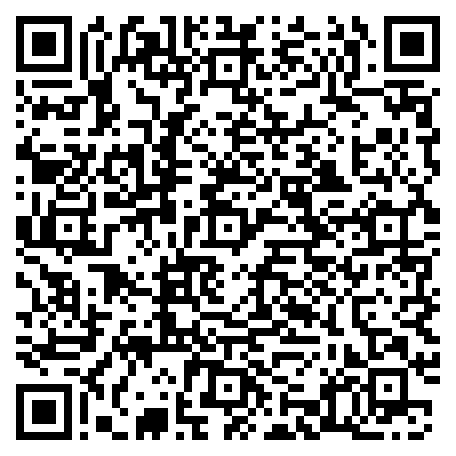

# VioDigital — Validação e Decodificação Criptográfica de Documentos Oficiais (Serpro / VIO)

> Verificador e decodificador **100% gratuito e Open Source** de documentos oficiais brasileiros (**CRLV-e, CNH, ATPV-e, CIN / Novo RG, TIE Marinha, CRAF e +160 templates VIO**) projetado para **computadores de cartórios, despachantes, empresas e cidadãos**.

> [!NOTE]
> **Aviso Legal e Não-Afiliação Institucional:** O **VioDigital** é um software livre e independente desenvolvido para a comunidade. Não possui qualquer vínculo, afiliação, representação ou endosso por parte do Serpro, SENATRAN, DETRANs ou órgãos públicos emissores. "VIO" é marca registrada de seus respectivos titulares. Consulte nossa [Política de Privacidade e Conformidade LGPD](https://viodigital.vercel.app/privacidade).

[](https://github.com/Kauerc10/VioDigital/actions/workflows/ci.yml)
[](LICENSE)
[](https://www.python.org/)
[](https://viodigital.vercel.app)
[](docs/adr/0001-offline-cryptographic-validation.md)

**Acesse gratuitamente no navegador:** [**https://viodigital.vercel.app**](https://viodigital.vercel.app)

---

## Por que o VioDigital nasceu? (De um Cartório para a Comunidade)

Na rotina diária de um **cartório de notas e registros**, escreventes e atendentes conferem dezenas de documentos veiculares (**CRLV-e**, **ATPV-e**) e de identificação (**CNH Digital e Física**, **CIN / Novo RG**, **Carteiras Funcionais**) todos os dias.

Apesar de todos esses documentos possuírem o **QR Code criptográfico oficial do Serpro/VIO**, quem trabalha no computador enfrentava sempre o mesmo problema:
1. O aplicativo oficial **Vio** existe apenas para celular, obrigando colaboradores a usarem seus próprios smartphones pessoais no balcão e digitarem manualmente no sistema notarial todos os dados lidos na telinha;
2. Todas as alternativas existentes para computador ou web eram **fechadas e pagas** (cobrando mensalidades caras ou taxas por cada documento consultado), além de exigirem o envio de documentos sensíveis de clientes para servidores de terceiros.

O **VioDigital** nasceu diretamente dessa necessidade real dentro do cartório: construir uma ferramenta **rápida, limpa, profissional, 100% gratuita e de código aberto**, onde o colaborador possa simplesmente **colar um print (`Ctrl+V`)**, **arrastar um PDF recebido no WhatsApp Web** ou **apontar o documento físico para a webcam do PC** e ter todos os dados validados criptograficamente e prontos para copiar em um clique.

Como essa dor é compartilhada por milhares de cartórios, despachantes, vistoriadores e pequenas empresas em todo o Brasil, decidimos disponibilizar o projeto de forma **totalmente aberta e comunitária**.

---

## Principais Funcionalidades

* **Múltiplas Formas de Entrada no Desktop:**
  * **Arraste e Solte (`Drag & Drop`):** Suporte direto a arquivos **PDF** (renderizados automaticamente a 300 DPI) e imagens (**PNG, JPEG, WebP**).
  * **Colagem Instantânea (`Ctrl + V`):** Cole capturas de tela (prints de WhatsApp Web, e-mail ou PDF) em qualquer lugar da página sem precisar salvar arquivo.
  * **Leitor Óptico via Webcam:** Escaneie documentos físicos impressos ou apresentados na tela do celular do cliente diretamente pela webcam do computador, com mira de enquadramento de alta densidade e captura automática.
* **Validação Criptográfica Offline (Padrão Serpro / ICP-Brasil):**
  * Desempacota os envelopes binários VIO (**versões 2, 4, 5 e 6** — compactação em 6-bit, 7-bit e BasE91) e tokens **JWS ES512** da **CIN (Carteira de Identidade Nacional)**.
  * Verifica matematicamente a **assinatura digital assimétrica (ECDSA / RSA)** contra o repositório local de certificados públicos oficiais da **SENATRAN / SERPRO / ONR**, sem depender de consulta paga.
* **Renderização de Fotografia Biométrica no Navegador:**
  * Decodifica nativamente imagens biométricas comprimidas no formato **BPG (*Better Portable Graphics*)** utilizado pelo Serpro dentro do QR Code da CNH e carteiras funcionais via WebAssembly (`bpgdec8.js`).
* **Produtividade Notarial:**
  * Formatação automática de máscaras (**Placa Mercosul/Antiga, CPF, CNPJ, RENAVAM**), botão de cópia individual por campo e botão **"Copiar Ficha Completa"** formatada para colagem direta em sistemas de gestão notarial.
* **Pipeline Multi-QR Resiliente:**
  * Quando um documento possui múltiplos QR Codes na mesma página (ex.: QR Code do Selo Digital do Tribunal de Justiça/Cartório + QR Code VIO da ATPV-e/CRLV-e, ou QR Code PIX de taxa do Detran), o motor prioriza automaticamente o envelope criptográfico VIO.

---

## Documentos Suportados (161 Templates Oficiais VIO + CIN)

O motor do VioDigital embarca o catálogo oficial de **161 templates do Serpro/VIO** (`templates.json`) mais as chaves públicas da **Carteira de Identidade Nacional (CIN)**:

| Categoria | Documentos Oficiais Suportados |
| :--- | :--- |
| **Trânsito e Veículos (SENATRAN / DETRAN / PRF)** | • **CRLV-e Digital** (Templates `10`, `12`, `62`, `70`)<br>• **CRV-e RENAVE** (Template `24`)<br>• **CNH Digital e Física** com Foto Biométrica (Templates `2`, `4`, `83`)<br>• **ATPV-e — Autorização para Transferência de Propriedade** (Template `43`)<br>• **Placa Veicular Mercosul** (`11`, `17`), **Credencial de Estacionamento** (`95`, `162`), **Boletim de Acidente PRF** (`50`, `51`) e **Carteira de Instrutor** (`237`) |
| **Identificação Civil Nacional** | • **CIN — Carteira de Identidade Nacional / Novo RG** (JWT ES512)<br>• **RG Digital Estadual** (`91`, `92`) e **DNI — Documento Nacional de Identidade** (`8`, `9`, `73`)<br>• **CPF Digital** (`25`) e **Identidade Estudantil MEC** (`23`, `236`) |
| **Marinha do Brasil / Náutica (DPC)** | • **TIE — Título de Inscrição de Embarcação PF e PJ** (Templates `116`, `118`)<br>• **CHA — Carteira de Habilitação de Amador e Motonauta** (`97`, `104`, `110`)<br>• **Certificados Marítimos DPC** (`141`, `151`, `167`) |
| **Exército, Armas (SFPC) e Segurança Pública** | • **CRAF — Certificado de Registro de Arma de Fogo** (`52`) e **Guia de Tráfego** (`53`)<br>• **Identidades Militares e Policiais** (Exército `108`, FAB `79`, Bombeiros `102`/`122`, PM `107`, Polícia Legislativa `128`/`129`, GCM `183`/`191`) |
| **Conselhos Profissionais e Identidades Funcionais** | • **CREA** (PR, RS, RN, SE, CE, TO, AL), **CRA** (SC, SP, RS, PR, ES, BA), **CREF**, **CREFITO**, **CFN**, **CONFERP**<br>• **Magistrados, Ministério Público e Defensoria Pública** (MPRS, MPPE, MPMG, MPTO, DPE-RS, DPE-AC, DPE-MA, DP-AM, TJAP, Senado) |
| **Saúde, Trabalho e Administração Federal** | • **Atestado Médico Digital — Ministério da Saúde** (`31`), **CAT — Comunicação de Acidente de Trabalho** (`229`), **Extrato CAUC / SICONFI / CAPAG** |

---

## Como Executar Localmente no seu Computador ou Rede do Cartório

O VioDigital pode ser usado diretamente pelo site [**viodigital.vercel.app**](https://viodigital.vercel.app) ou instalado localmente em qualquer computador Windows, Linux ou macOS para operação **100% offline na rede interna do cartório**:

### 1. Pré-requisitos
* **Python 3.12+** instalado.

### 2. Instalação e Execução Rápida
```bash
# Clone o repositório
git clone https://github.com/Kauerc10/VioDigital.git
cd VioDigital

# Instale as dependências com suporte a servidor local e visão computacional
pip install -e ".[server,vision]"

# Inicie o servidor local
python -m viodigital
```

Abra o navegador em **`http://127.0.0.1:8000`** e pronto!

#### Auto-Atualização Local e Cache Inteligente (100% Offline)
* **Recompilação Automática do Motor WASM:** Ao iniciar o servidor (`python -m viodigital`), o sistema verifica o hash SHA-256 local do núcleo (`src/viodigital/core`) contra `.wheel_hash`. Havendo alteração no código, a wheel WebAssembly (`viodigital-*.whl`) é atualizada automaticamente em milissegundos, sem depender de rede.
* **Service Worker Híbrido (`sw.js`):** Os runtimes pesados (`Pyodide`, `ZXing`, `PDF.js`) permanecem em **Cache-First** para abertura instantânea e uso offline, enquanto o motor `.whl`, JS, CSS e HTML utilizam **Network-First com fallback offline** e invalidação automática por hash de build (`/api/version`). Assim, nenhuma alteração fica presa em cache antigo.

### 3. Executando os Testes Automatizados
```bash
pytest
```

---

## Estrutura do Repositório e Documentação

```text
VioDigital/
├── src/viodigital/
│   ├── api/                 # Servidor FastAPI e endpoints REST (/api/documents/verify)
│   ├── core/                # Motor criptográfico VIO/CIN, leitor multi-QR e catálogo de certificados
│   │   ├── data/            # Catálogo oficial de 161 templates e chaves públicas ICP-Brasil/SENATRAN
│   │   ├── documents/       # Handlers tipados por documento (CRLV, CNH, ATPV, CIN, RG, DNI, Generic)
│   │   └── formats/         # Desempacotadores binários v2, v4, v5, v6 (6-bit, 7-bit, BasE91) e JWS
│   └── web/                 # Interface web clean inspirada no Detran Digital + Scanner Webcam + BPG Wasm
├── docs/
│   ├── adr/                 # Registros de Decisão de Arquitetura (ADRs)
│   ├── agents/              # Configuração de engenharia e fluxo de trabalho para Agentes
│   └── vio-reverse-engineering.md  # Especificação técnica detalhada do protocolo binário VIO
├── tests/                   # Suíte de testes unitários e de integração (Pytest)
├── CONTEXT.md               # Glossário do domínio notarial e premissas operacionais
├── CONTRIBUTING.md          # Guia para contribuidores da comunidade
└── LICENSE                  # Licença MIT
```

* [Glossário do Domínio e Conceitos Notariais (`CONTEXT.md`)](CONTEXT.md)
* [Engenharia Reversa e Especificação Técnica do Padrão VIO (`docs/vio-reverse-engineering.md`)](docs/vio-reverse-engineering.md)
* [ADR 0001: Validação Criptográfica Offline Local](docs/adr/0001-offline-cryptographic-validation.md)
* [ADR 0002: Arquitetura do Decodificador e Interface Web](docs/adr/0002-crlv-and-cnh-decoding-architecture.md)
* [ADR 0003: Validação 100% no Navegador via WebAssembly (Pyodide)](docs/adr/0003-browser-wasm-pyodide-validation.md)
* [Avisos e Licenças de Terceiros (`THIRD_PARTY_NOTICES.md`)](THIRD_PARTY_NOTICES.md)
* [Guia de Contribuição (`CONTRIBUTING.md`)](CONTRIBUTING.md)

---

## Créditos e Agradecimentos

O espírito do Open Source é construir sobre o trabalho incrível da comunidade:

* O núcleo base de decodificação criptográfica dos formatos VIO e CIN em Python teve como ponto de partida a excelente biblioteca open-source [**`digital-document-checker`**](https://github.com/helviojunior/digital-document-checker), criada por **Helvio Junior (`@helviojunior` / `M4v3r1ck`)** sob licença MIT.
* A partir dessa base, o **VioDigital** expandiu o motor e construiu a plataforma completa voltada à operação notarial e corporativa, adicionando:
  * Handlers dedicados para **CRLV-e Digital**, **CRV-e RENAVE (Template 24)** e **ATPV-e (Template 43)** com normalização de campos;
  * Pipeline de visão computacional **Multi-QR** com `zxing-cpp` e `OpenCV` para documentos com múltiplos selos e correção de codificação binária;
  * Renderização direta de fotografias biométricas **BPG em HTML5 Canvas via WebAssembly** no navegador;
  * **Scanner Óptico via Webcam** com recorte inteligente de alta densidade, suporte a colagem via **`Ctrl+V`** e interface web institucional completa.

---

## Apoie o Projeto (Mantenha o VioDigital Gratuito)

O **VioDigital** foi criado para continuar sendo **gratuito, aberto e acessível** para qualquer escrevente, cartório, despachante ou cidadão brasileiro, sem cobrar por documento verificado.

Se esta ferramenta economiza tempo e dinheiro no seu dia a dia, considere apoiar a manutenção do projeto:
* ⭐ Deixe uma **Estrela (Star)** neste repositório no GitHub e compartilhe com colegas de outros cartórios e escritórios!
* 💬 Acompanhe e envie feedbacks, ideias e melhorias através das [Issues do GitHub](https://github.com/Kauerc10/VioDigital/issues).
* ☕ **Apoie voluntariamente via PIX:**

<div align="center">
  <br>
  <strong>Chave Aleatória:</strong> <code>84afcca1-eea6-4a15-9adf-581b37fb5897</code><br>
  <em>Beneficiário: Kaue Ruon Cardoso · Cidade: São Paulo</em>
</div>

<details>
<summary>📋 Clique aqui para ver o código <strong>Pix Copia e Cola</strong></summary>

```text
00020126720014br.gov.bcb.pix013684afcca1-eea6-4a15-9adf-581b37fb58970210VIODIGITAL5204000053039865802BR5917KAUE RUON CARDOSO6009Sao Paulo62260522ApoioProjetoVioDigital6304383F
```
</details>

Ou acesse a [página de apoio no VioDigital](https://viodigital.vercel.app/apoiar).

---

## Licença

Distribuído sob a **Licença MIT**. Consulte o arquivo [`LICENSE`](LICENSE) para mais informações.
