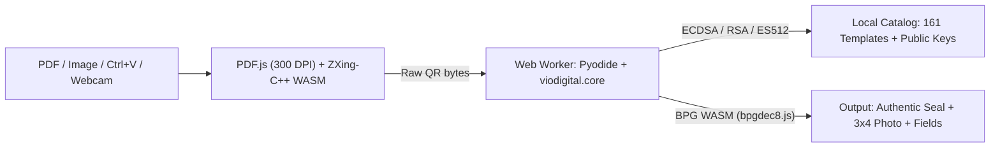

# VioDigital — Playbook de Lançamento Público e Kit de Divulgação

Guia operacional para o lançamento público do **VioDigital** (`Kauerc10/VioDigital` · `https://vioweb.vercel.app`) com foco em **adoção orgânica**, **transparência técnica** e **concentração coordenada de descoberta em janela de 24–48h** para ranqueamento em **GitHub Trending → Python**.

> [!IMPORTANT]
> **Política Ética e Regras das Comunidades (Sem Manipulação):**
> * **É estritamente proibido** pedir votos combinados (*upvote rings*), trocas de stars ("star for star"), contas falsas, grupos de engajamento artificial ou compra de tráfego/anúncios para inflar métricas.
> * **Hacker News, Reddit e TabNews** aplicam penalidades automáticas (shadowban/downrank) contra links compartilhados com pedidos de upvote ou texto promocional exagerado.
> * Cada comunidade deve receber **conteúdo técnico genuinamente adaptado às suas regras**, com código auditável, contexto real e dados **100% sintéticos** (`JOAO DA SILVA`, placa `ABC1D23`, RENAVAM `01122334455`).

---

## 1. Checklist Pré-Lançamento (Obrigatório Antes do Dia D)

Execute e marque todos os itens abaixo **pelo menos 24 horas antes** da primeira publicação:

### Repositório & Engenharia
- [ ] **Suíte verde no `main`:** `ruff check .`, `python src/viodigital/build_static.py` e `pytest` (incluindo `tests/test_e2e_privacy.py` com Playwright) passando 100% no GitHub Actions.
- [ ] **Metadados GitHub (`About` & `Topics`):** descrição em uma frase, homepage apontando para `https://vioweb.vercel.app` e topics configurados (`python`, `pyodide`, `webassembly`, `wasm`, `qrcode`, `cryptography`, `icp-brasil`, `serpro`, `lgpd`, `privacy`, `offline-first`, `pwa`, `fastapi`, `brazil`, `cartorio`, `crlv`, `cnh`).
- [ ] **Classificação Linguist:** confirmar na barra lateral do repositório no GitHub que a linguagem primária exibida é **Python** (necessário para competir em **GitHub Trending → Python**).
- [ ] **Release `v0.2.0` & `CHANGELOG.md`:** tag `v0.2.0` publicada no GitHub Releases com notas claras e imagem container publicada em `ghcr.io/kauerc10/viodigital`.
- [ ] **Smoke test do container offline:** executar `docker compose up --build` (ou `docker run -p 8000:8000 ghcr.io/kauerc10/viodigital:latest`) e confirmar `GET http://127.0.0.1:8000/api/health` retornando `{"status": "ok", ...}` sem acesso à internet.
- [ ] **Assets visuais & LGPD:** confirmar que `docs/assets/demo-validation.gif` e `docs/assets/screenshot-result.png` renderizam corretamente tanto no `README.md` quanto no `README.en.md`, exibindo exclusivamente dados fictícios (`JOAO DA SILVA` / `ABC1D23`).
- [ ] **Saúde da comunidade:** `CODE_OF_CONDUCT.md`, `SECURITY.md`, `CONTRIBUTING.md`, templates de Issue/PR ativos e pelo menos **3 `good first issue`** abertas (ex.: handlers tipados para Marinha TIE/CHA, Exército CRAF/Guia e Conselhos Profissionais).

### Passos Manuais do Mantenedor
- [ ] **Upload manual da Social Preview do GitHub (obrigatório — sem API pública):**
  1. Acesse no GitHub: **Settings → General → Social preview → Edit → Upload an image...**
  2. Envie o arquivo [`docs/assets/social-preview.png`](assets/social-preview.png) (`1280×640`).
  3. Confirme que links compartilhados do repositório passam a exibir o card customizado do VioDigital.
- [ ] **Validação dos cards OpenGraph do site (`https://vioweb.vercel.app`):**
  * Teste a URL canônica no [LinkedIn Post Inspector](https://www.linkedin.com/post-inspector/), no depurador do X/Twitter e em uma conversa de teste do WhatsApp/Telegram para confirmar o banner OpenGraph `1200×630`.
- [ ] **Publicação no PyPI (Opcional):**
  * Caso queira habilitar `pip install viodigital` diretamente do PyPI antes ou depois do lançamento (requer credencial / Trusted Publisher do mantenedor):
    ```bash
    python -m pip install --upgrade build twine
    python -m build
    twine check dist/*
    twine upload dist/*
    ```
  * Em seguida, valide em um `venv` limpo: `pip install viodigital && viodigital --help`.

---

## 2. Textos Prontos por Canal (Adaptados às Regras de Cada Comunidade)

### 2.1 TabNews (PT-BR — História + Engenharia Real)

> **Diretrizes do TabNews:** Valoriza problemas reais, profundidade técnica, código aberto e transparência. Evite tom publicitário; conte a dor do cartório, a arquitetura Pyodide + WASM e convide críticas técnicas.

* **Título sugerido:**
  `Como construí um validador criptográfico offline de CRLV-e, CNH e CIN em Python + WebAssembly (Pyodide) dentro de um cartório`
* **Corpo:**

```markdown
Na rotina diária de um cartório, escreventes conferem dezenas de documentos oficiais todos os dias (CRLV-e, ATPV-e, CNH, CIN/Novo RG). Todos eles trazem um QR Code assinado criptograficamente pelo Serpro/SENATRAN ou pela ICP-Brasil (no caso da CIN).

O atrito no balcão sempre foi o mesmo:
1. O app oficial do governo existe só para celular — obrigando o atendente a usar o aparelho pessoal e redigitar tudo no sistema do computador;
2. As ferramentas web que apareciam no Google eram fechadas, cobravam por consulta ou mensalidade e exigiam upload de PDFs com CPF, placa, chassi e foto biométrica para servidores de terceiros.

Decidi resolver isso com software livre (Licença MIT): o **VioDigital** ([https://vioweb.vercel.app](https://vioweb.vercel.app) | [GitHub](https://github.com/Kauerc10/VioDigital)).

### Como funciona por baixo dos panos (0 dados enviados ao servidor)

O desafio técnico era não manter dois motores divergentes (um em Python e outro em JavaScript) para os **161 templates oficiais VIO** e desempacotadores binários (`6-bit`, `7-bit`, `BasE91`, envelopes v2/v4/v5/v6 e tokens JWS ES512 da CIN).

A solução foi rodar o **mesmo motor Python (`viodigital.core`)** direto no navegador via **WebAssembly**:

1. **PDF.js + ZXing-C++ WASM:** rasteriza PDFs localmente a 300 DPI (ou captura frames da webcam / `Ctrl+V`) e extrai os bytes brutos do QR Code dentro de um Web Worker isolado, priorizando o envelope VIO quando a folha tem múltiplos QR Codes (ex.: selo do TJ ou QR de taxa PIX).
2. **Pyodide + `cryptography` em WASM:** verifica a assinatura digital (ECDSA P-256 / RSA / ES512) contra as chaves públicas oficiais embarcadas localmente.
3. **BPG em WebAssembly (`bpgdec8.js`):** decodifica a fotografia biométrica comprimida em *Better Portable Graphics* dentro do QR da CNH direto para um `<canvas>`.
4. **Prova verificável no DevTools e CSP:** o site público serve arquivos estáticos com `Content-Security-Policy: connect-src 'self'` (sem `'unsafe-eval'`), bloqueando no próprio navegador qualquer tentativa de `fetch`/`XHR` externo. Dá para abrir o F12 → Network, desligar o Wi-Fi e validar normalmente.

Para ambientes com intranet restrita, o repositório também sobe via `python -m viodigital` ou `docker compose up --build` (FastAPI + PyMuPDF + OpenCV + zxing-cpp).

### Créditos e Limite Jurídico Importante
* O núcleo inicial partiu da excelente biblioteca MIT [`digital-document-checker`](https://github.com/helviojunior/digital-document-checker) do Helvio Junior (`@helviojunior`).
* **Distinção notarial:** validar o QR Code atesta a **autenticidade e integridade na emissão**, mas restrições posteriores (Renajud, alienação nova, suspensão de CNH) continuam exigindo consulta online no DETRAN/RENAVAM.

Se alguém tiver interesse em ajudar com handlers tipados para os templates ainda genéricos (TIE Marinha, CRAF Exército, CREA/CRA), deixei issues abertas no GitHub. Críticas técnicas na arquitetura e no CSP são muito bem-vindas!
```

---

### 2.2 Reddit Brasil (`r/brdev`, `r/devBR`, `r/pythonbrasil`)

> **Regra anti-spam:** Nunca publique o mesmo texto idêntico nos três subreddits ao mesmo tempo. Escolha o ângulo técnico de cada comunidade e espace as postagens (veja o cronograma na Seção 5).

#### `r/brdev` (Foco: Problema real + WebAssembly + Arquitetura)
* **Título:** `Fiz um validador 100% offline e open source de CRLV-e, CNH, ATPV-e e CIN direto no navegador (Python + Pyodide WASM)`
* **Texto:**
```markdown
Pessoal, queria compartilhar um projeto open source (MIT) que construí a partir de uma dor real de trabalho em cartório: o **VioDigital**.

Todo mundo que já precisou conferir um CRLV-e, ATPV-e ou CNH no computador sabe que o app oficial (Vio) é só mobile, e as alternativas web cobram por consulta além de mandar PDF com CPF, placa, chassi e foto da pessoa pro servidor dos outros.

No VioDigital ([https://vioweb.vercel.app](https://vioweb.vercel.app) / [repositório no GitHub](https://github.com/Kauerc10/VioDigital)):
- Você pode **colar um print com `Ctrl+V`** do WhatsApp Web, arrastar o **PDF** ou ler pela **webcam** do PC.
- Tudo roda **100% no navegador via WebAssembly** (`PDF.js` → `ZXing-C++ WASM` → `Pyodide` rodando `viodigital.core` + `cryptography` → `bpgdec8.js` para a foto 3x4 BPG da CNH).
- O header CSP usa `connect-src 'self'`, então o próprio navegador impede qualquer tráfego externo (dá para auditar no F12 → Network ou desligando o Wi-Fi).
- Para quem quiser rodar na intranet de empresa/cartório sem depender de nada, tem CLI Python, servidor FastAPI e `docker compose up --build`.

O núcleo inicial veio da biblioteca MIT `digital-document-checker` (`@helviojunior`) e fomos expandindo com handlers de CRLV/RENAVE/ATPV, pipeline Multi-QR (para ignorar selo do TJ e QR do PIX na mesma página) e scanner webcam.

Qualquer feedback de UX, segurança ou PR em handlers de novos templates (Marinha, Exército, conselhos profissionais) é bem-vindo!
```

#### `r/devBR` (Foco: Software livre brasileiro + Bastidores de produto)
* **Título:** `Projeto Open Source BR: leitor e validador offline de documentos Serpro/VIO e CIN direto no navegador (zero upload de dados)`
* **Texto:**
```markdown
Compartilhando o **VioDigital** ([GitHub](https://github.com/Kauerc10/VioDigital) | [App Web](https://vioweb.vercel.app)), um projeto aberto sob licença MIT que nasceu dentro de um cartório para substituir a digitação manual e ferramentas pagas de validação de QR Code de **CRLV-e, CNH, ATPV-e e CIN (Novo RG)**.

Alguns aprendizados legais da construção:
- **Por que Pyodide/WASM em vez de reescrever em JS:** os envelopes VIO têm 4 versões binárias (`v2`, `v4`, `v5`, `v6`), compactação em `6-bit`, `7-bit` e `BasE91`, além de 161 templates oficiais e JWS `ES512` da CIN. Compilar a wheel Python pura e rodar dentro de um Web Worker garantiu 1 único motor testado por `pytest` rodando igual no navegador, na CLI e no Docker.
- **Foto biométrica BPG:** o Serpro comprime a foto 3x4 da CNH em *Better Portable Graphics* (BPG) sem o cabeçalho mágico — reinserimos o header em memória e decodificamos direto em `<canvas>` via `bpgdec8.js` (WASM).
- **Privacidade verificável:** teste E2E com Playwright valida que o CSP `connect-src 'self'` bloqueia qualquer chamada externa.

Feedbacks da comunidade são super bem-vindos!
```

#### `r/pythonbrasil` (Foco: Python no navegador, CLI, FastAPI e empacotamento)
* **Título:** `VioDigital: rodando um motor criptográfico Python (cryptography + 161 parsers binários) no navegador com Pyodide, CLI e FastAPI`
* **Texto:**
```markdown
Fala pessoal! Quero mostrar como estruturamos o **VioDigital** ([Kauerc10/VioDigital](https://github.com/Kauerc10/VioDigital)) para rodar o mesmo pacote Python 3.12+ em três ambientes sem duplicar código:

1. **No navegador (Pyodide WASM):** durante o build estático (`build_static.py`), empacotamos `viodigital.core` em uma wheel pura (`viodigital-0.2.0-py3-none-any.whl`) com invalidação por hash SHA-256 (`.wheel_hash`). Um Web Worker instala essa wheel em memória junto ao binário `wasm32` de `cryptography` e valida assinaturas ECDSA/RSA/ES512 offline.
2. **Na CLI / Biblioteca (`pip install -e ".[server,vision]"`):** `viodigital documento.pdf --json --save-photo foto.png` ou `DigitalDocumentChecker().parse_file(...)`.
3. **Self-hosted (`python -m viodigital` / Docker):** servidor FastAPI local para intranets de cartórios.

A base criptográfica inicial vem do `digital-document-checker` (MIT) e o repositório conta com suíte `pytest`, `ruff`, documentação de engenharia reversa do protocolo VIO e `good first issue` abertas para quem quiser contribuir com novos `DocumentHandler`s.
```

---

### 2.3 Hacker News (`Show HN`)

> **Regras estritas do Hacker News:**
> * Título deve começar com `Show HN:`, ter no máximo ~80 caracteres e **ZERO superlativos** (proibido: *"100% free"*, *"best"*, *"revolutionary"*, *"zero-cost"*, emojis).
> * URL aponta para `https://github.com/Kauerc10/VioDigital` (ou `https://vioweb.vercel.app` — para projetos dev/open source, o repositório GitHub costuma reter melhor atenção técnica com link para o demo ao vivo no topo).
> * Publique o **Maker's Comment** imediatamente após submeter.

* **Title (71 caracteres — sem superlativos):**
  `Show HN: VioDigital – Offline Brazilian ID verifier in Pyodide and WASM`
* **URL:**
  `https://github.com/Kauerc10/VioDigital`
* **Maker's Comment (postar logo após criar a submissão):**

```text
Hi HN! I built VioDigital to solve a workflow bottleneck in Brazilian notary offices (cartórios), where clerks verify dozens of vehicle titles (CRLV-e, ATPV-e), driver's licenses (CNH), and national IDs (CIN) every day.

Every one of those documents includes a high-density cryptographic QR Code signed by Serpro/SENATRAN (using custom binary envelopes v2/v4/v5/v6 with 6-bit, 7-bit, and BasE91 packing) or ICP-Brasil (ES512 compact JWS for the new CIN national ID). Yet the official government verifier app is mobile-only, forcing clerks to use personal phones and retype fields by hand, while existing web tools were closed-source, charged per lookup, and uploaded sensitive citizen PII to remote servers.

VioDigital shares a single Python 3.12 core (`viodigital.core`) across three modes:

1. **Static Browser / PWA (`https://vioweb.vercel.app`):** PDFs are rasterized locally via PDF.js at 300 DPI (or pasted via Ctrl+V / read from a webcam), decoded into raw bytes by ZXing-C++ WASM inside a Web Worker, and cryptographically verified in-memory by Pyodide running Python's `cryptography` wasm32 wheel against 161 bundled government templates and public keys. Embedded CNH biometric portraits (stored as headerless BPG images) are decoded directly to Canvas via `bpgdec8.js` (libbpg in WASM).
2. **Privacy Enforcement:** The static app ships with `Content-Security-Policy: connect-src 'self'` (no `unsafe-eval`, only `wasm-unsafe-eval`) and `Referrer-Policy: no-referrer`, verified by a Playwright E2E test that asserts zero external requests and blocked outbound `fetch()`. You can open DevTools Network, go offline, and validate documents normally.
3. **Self-Hosted / CLI (`docker compose up --build` or `pip`):** FastAPI + PyMuPDF + zxing-cpp + OpenCV for air-gapped office intranets or batch JSON/photo extraction.

One domain nuance we make explicit to users: offline QR verification proves **document authenticity and integrity at issuance time**, not real-time registry status (subsequent judicial blocks or license suspensions still require querying DETRAN online).

The initial cryptographic parsing core builds on Helvio Junior's MIT-licensed `digital-document-checker`. I'd love feedback on the multi-WASM worker architecture, CSP hardening, and any edge cases you spot.
```

---

### 2.4 Reddit Global (`r/selfhosted`, `r/privacy`, `r/Python`, `r/webassembly`)

> **Regra:** Adapte cada postagem ao foco do subreddit e respeite o intervalo do cronograma para não parecer spam cruzado.

#### `r/selfhosted`
* **Title:** `VioDigital – Self-hostable, air-gapped cryptographic verifier for Brazilian government QR documents (Docker / FastAPI / Pyodide WASM)`
* **Body:**
```markdown
**VioDigital** ([GitHub](https://github.com/Kauerc10/VioDigital) | [Live Static Demo](https://vioweb.vercel.app)) is an MIT-licensed, offline-first cryptographic verifier and decoder for Brazilian government QR-coded documents (vehicle registrations CRLV-e/ATPV-e, CNH driver's licenses with biometric portraits, CIN national IDs, and 161 official Serpro/VIO templates).

### Why self-host it?
Notary offices, legal teams, and dispatchers deal with sensitive citizen PII every day. Closed-source SaaS tools charge per document and upload PDFs to third-party servers. VioDigital runs entirely inside your local intranet with zero outbound network calls.

### Deployment
```bash
git clone https://github.com/Kauerc10/VioDigital.git
cd VioDigital
docker compose up --build
```
Or pull from GHCR:
```bash
docker run -d -p 8000:8000 ghcr.io/kauerc10/viodigital:latest
```
* Multi-stage non-root container (`viodigital` user) exposing port `8000`
* Healthcheck endpoint at `GET /api/health`
* Runs either as a pure static WASM PWA (validation inside the client's browser via Pyodide + ZXing WASM + PDF.js) or via local FastAPI REST endpoints (`/api/documents/verify`) for internal ERP integrations.

Feedback on the Docker setup and self-hosting ergonomics is very welcome!
```

#### `r/privacy`
* **Title:** `How we built a client-side cryptographic ID verifier in WebAssembly with verifiable zero-network CSP (connect-src 'self')`
* **Body:**
```markdown
In Brazil, official vehicle registrations (CRLV-e), driver's licenses (CNH with biometric photo), and the new National ID (CIN) embed cryptographically signed payloads inside QR Codes. Unfortunately, most desktop web "verifiers" ask users to upload full PDFs containing CPF (tax ID), home address, vehicle VIN, and portrait photos to unknown third-party servers.

We built **VioDigital** ([GitHub](https://github.com/Kauerc10/VioDigital) | [Web App](https://vioweb.vercel.app)) under the MIT license so verification happens **strictly in local browser memory**:

* **Client-side WASM pipeline:** `PDF.js` (300 DPI) → `ZXing-C++ WASM` → `Pyodide` (Python 3.12 + `cryptography` wasm32) → `libbpg` WASM (`bpgdec8.js`) for biometric portraits.
* **Browser-enforced isolation:** Served with `Content-Security-Policy: default-src 'self'; connect-src 'self'; ...` (no `'unsafe-eval'`, only `'wasm-unsafe-eval'`) and `Referrer-Policy: no-referrer`.
* **Auditable in 10 seconds:** Open DevTools (`F12`) → Network tab → switch to Offline mode (or check Preserve log) and paste (`Ctrl+V`) or drop a document. Zero bytes leave the machine. Our CI runs a Playwright E2E test verifying that even an injected external `fetch()` is blocked by CSP.

All demo screenshots/GIFs in the repo use synthetic test fixtures only. Happy to answer questions about the threat model or CSP setup!
```

#### `r/Python`
* **Title:** `Sharing one pure-Python 3.12 core across CLI, FastAPI, and in-browser Pyodide WASM (cryptography + 161 binary document parsers)`
* **Body:**
```markdown
We built **VioDigital** ([GitHub](https://github.com/Kauerc10/VioDigital)) to decode and cryptographically verify Brazilian government QR-coded documents (Serpro/VIO binary envelopes v2/v4/v5/v6 using 6-bit, 7-bit, and BasE91 packing + ECDSA/RSA signatures, plus ICP-Brasil ES512 compact JWS for the new national ID).

The fun Python engineering part was avoiding two separate codebases (Python backend vs JS frontend):
* During build (`src/viodigital/build_static.py`), we package `viodigital.core` into a pure-Python wheel (`viodigital-0.2.0-py3-none-any.whl`) and track a deterministic SHA-256 hash (`.wheel_hash`) of core files so local servers auto-rebuild the wheel in milliseconds whenever source files change.
* In the browser, a dedicated Web Worker (`scanner.worker.js`) loads Pyodide + Pyodide's precompiled `cryptography` wasm32 wheel + our local `.whl`, verifying signatures locally in memory.
* The exact same `DigitalDocumentChecker` class powers the CLI (`viodigital doc.pdf --json`), the Python library API, and a self-hosted FastAPI/Docker container (`PyMuPDF` + `zxing-cpp` + `OpenCV`).

Would love feedback on the packaging/wheel-invalidation pattern and typed `DocumentHandler` architecture!
```

#### `r/webassembly`
* **Title:** `Chaining PDF.js + ZXing-C++ WASM + Pyodide (cryptography) + libbpg WASM inside a Web Worker for offline document verification`
* **Body:**
```markdown
I wanted to share a production WebAssembly pipeline we built for **VioDigital** ([GitHub](https://github.com/Kauerc10/VioDigital) | [Live App](https://vioweb.vercel.app)), an offline verifier for Brazilian government QR documents.

Instead of porting 161 binary document schemas and 6-bit/7-bit/BasE91 unpackers from Python to JS, we chained four WASM/JS components cleanly:
1. **PDF.js** rasterizes multi-page PDFs locally at 300 DPI.
2. **ZXing-C++ (`zxing_reader.wasm`)** extracts raw binary payloads from high-density QR codes inside a dedicated Web Worker (with custom sharpness/burst/upscale fallbacks for webcam frames).
3. **Pyodide + `cryptography` (`wasm32`)** installs our pure-Python `viodigital.core` wheel in memory and validates ECDSA/RSA/ES512 signatures against bundled public certificates.
4. **`bpgdec8.js` (Emscripten/WASM port of `libbpg`)** decodes headerless BPG biometric portrait photos embedded inside driver's licenses directly onto an HTML5 Canvas.

CSP uses `'wasm-unsafe-eval'` (zero `'unsafe-eval'`) and `connect-src 'self'`, and a hybrid Service Worker keeps the ~19 MB Pyodide/WASM vendor runtime in `Cache-First` while keeping the app wheel/JS in `Network-First` with build-hash invalidation. Curious how others here structure multi-WASM worker pipelines and cache invalidation!
```

---

### 2.5 LinkedIn (PT-BR — História Notarial + Demonstração Visual)

> **Dica de alcance:** No LinkedIn, anexe `docs/assets/demo-validation.gif` (ou vídeo curto gravado a partir do roteiro da Seção 3) diretamente no post e coloque o link no corpo ou no primeiro comentário conforme preferência atual do algoritmo.

```text
No dia a dia de um cartório, um detalhe aparentemente simples trava o balcão dezenas de vezes por dia: conferir o QR Code oficial do CRLV-e, da ATPV-e, da CNH ou da nova CIN.

O aplicativo oficial (Vio) só existe para celular. Resultado? O colaborador acaba usando o próprio smartphone no atendimento e digitando campo por campo na tela do sistema notarial. E quase toda alternativa na web cobra por consulta ou exige subir o PDF com CPF, placa, chassi e foto do cliente para servidores terceiros — um problema sério de LGPD.

Por isso nasceu o VioDigital: uma ferramenta 100% gratuita, offline e Open Source (Licença MIT) feita de um cartório para a comunidade.

Como funciona na prática:
✅ Cole um print do WhatsApp Web com Ctrl+V, arraste o PDF ou aponte o documento para a webcam
✅ Validação criptográfica da assinatura SERPRO/SENATRAN e ICP-Brasil direto na memória do navegador (via WebAssembly / Pyodide)
✅ Decodificação da foto biométrica 3x4 da CNH e cópia dos campos formatados em 1 clique
✅ Zero dados trafegados para fora da máquina — auditável na aba Rede (F12) com CSP connect-src 'self'
✅ Suporte a +160 templates oficiais VIO + CIN e opção de instalação local via Python ou Docker para intranets de cartórios

Aviso importante: a verificação atesta a autenticidade criptográfica na emissão (não substitui consultas online no DETRAN/RENAVAM para restrições supervenientes quando exigido pelo ato).

Código aberto no GitHub (e disponível gratuitamente no navegador):
🌐 Site: https://vioweb.vercel.app
💻 GitHub: https://github.com/Kauerc10/VioDigital

Se você trabalha em cartório, escritório de despachante ou tecnologia jurídica, teste com um documento e me conte o que achou! (O vídeo/GIF acima usa exclusivamente dados fictícios de teste.)

#OpenSource #Python #WebAssembly #LGPD #Cartório #GovTech #Privacidade #SegurançaDaInformação
```

---

### 2.6 Dev.to / Hashnode (EN — Artigo Técnico Completo)

* **Title:** `Running a Python Cryptographic Document Verifier Entirely in the Browser with Pyodide, ZXing WASM, and Strict CSP`
* **Tags:** `python`, `webassembly`, `privacy`, `opensource`
* **Canonical URL:** *(se publicar em blog próprio primeiro, definir canonical)*
* **Estrutura e rascunho pronto para publicar:**

```markdown
---
title: Running a Python Cryptographic Document Verifier Entirely in the Browser with Pyodide, ZXing WASM, and Strict CSP
published: false
description: How we eliminated server-side uploads of sensitive Brazilian IDs and vehicle titles by running our Python 3.12 cryptographic core inside a browser Web Worker.
tags: python, webassembly, privacy, opensource
---

## The Problem: Sensitive PII Meets Closed-Source Web Tools

Every Brazilian driver's license (CNH), vehicle registration (CRLV-e), electronic transfer authorization (ATPV-e), and new National ID (CIN) carries a high-density cryptographic QR Code signed by government HSMs.

Inside a notary office (*cartório*), clerks check these documents all day on desktop PCs. Because the official government app is mobile-only, clerks either retype data from personal phones or resort to closed-source web tools that charge per check and upload full PDFs containing tax IDs, addresses, license plates, and biometric photos to remote servers.

We built **[VioDigital](https://github.com/Kauerc10/VioDigital)** (MIT License, live at [vioweb.vercel.app](https://vioweb.vercel.app)) to keep verification **100% client-side, offline-capable, and auditable**.

## Why WebAssembly Instead of Rewriting Everything in JavaScript?

The Python engine (`viodigital.core`, originally built atop `@helviojunior`'s MIT-licensed `digital-document-checker`) already handled:
* Four VIO binary envelope versions (`v2`, `v4`, `v5`, `v6`) with `6-bit`, `7-bit`, and `BasE91` text packing;
* `ECDSA P-256`, `RSA`, and `ES512` JWS signature verification via `cryptography`;
* **161 official document templates** plus CIN public keys.

Porting bit-level unpackers and 161 schemas to JS would create two diverging codebases. Instead, we run **one Python core** everywhere — CLI, self-hosted FastAPI/Docker, and browser WASM.

## The Browser Multi-WASM Pipeline



1. **PDF.js & Webcam Capture:** Renders PDFs locally at 300 DPI or grabs webcam frames enhanced with `camera-quality.js`.
2. **ZXing-C++ WASM (`zxing_reader.wasm`):** Extracts raw binary QR bytes without corrupting non-UTF-8 bytes, automatically prioritizing the VIO/CIN QR when court seals or payment QRs appear on the same page.
3. **Pyodide inside `scanner.worker.js`:** Installs our pure-Python `viodigital-0.2.0-py3-none-any.whl` and Pyodide's prebuilt `cryptography` `wasm32` wheel in memory.
4. **`bpgdec8.js` (libbpg WASM):** Reinserts the stripped `BPG` magic header from driver's license portraits and renders the biometric photo onto an HTML5 Canvas.

## Verifiable Zero-Network Privacy (`connect-src 'self'`)

Trust shouldn't rely on promises. We ship every HTML page and static response with:

```http
Content-Security-Policy: default-src 'self'; connect-src 'self'; script-src 'self' 'unsafe-inline' 'wasm-unsafe-eval' blob:; worker-src 'self' blob:; img-src 'self' data: blob:; style-src 'self' 'unsafe-inline'; font-src 'self'; manifest-src 'self';
```

Notice two critical details:
* `connect-src 'self'` makes the browser itself block any external `fetch`, `XHR`, or `WebSocket`.
* `'wasm-unsafe-eval'` allows WebAssembly compilation **without** enabling `'unsafe-eval'` for JavaScript.

Our Playwright suite (`tests/test_e2e_privacy.py`) explicitly verifies that outbound `fetch()` calls fail under CSP and zero external network requests are triggered during document verification.

## Self-Hosting for Air-Gapped Intranets

Need an internal deployment with no external internet access at all?

```bash
git clone https://github.com/Kauerc10/VioDigital.git
cd VioDigital
docker compose up --build
```

## Try It & Contribute

* Web app: [https://vioweb.vercel.app](https://vioweb.vercel.app)
* Source code & `good first issue` tickets: [https://github.com/Kauerc10/VioDigital](https://github.com/Kauerc10/VioDigital)
```

---

## 3. Roteiro de Vídeo Curto (30–60s — Reels / Shorts / TikTok / LinkedIn)

> [!CAUTION]
> **Regra obrigatória para gravação:** Grave a tela utilizando **exclusivamente documentos sintéticos/fictícios** (`JOAO DA SILVA`, placa `ABC1D23`, RENAVAM `01122334455`, chassi `9BWZZZ377VT004251`). Nunca mostre documentos reais na gravação!

| Tempo | Visual na Tela | Locução / Legenda (PT-BR) | Subtitles (EN) |
| :--- | :--- | :--- | :--- |
| **0–5s (Gancho)** | Close rápido em alguém tentando ler QR Code de um CRLV-e no celular e digitando no PC. Texto na tela: *"Ainda digitando CRLV-e do celular no PC?"* | "Você ainda usa celular pessoal no balcão para ler QR Code de CRLV-e e CNH e digitar tudo à mão?" | "Still scanning official QR codes on a phone and retyping fields on PC?" |
| **5–18s (A Dor)** | Tela mostrando sites genéricos pedindo upload / cobrança. Transição limpa para `https://vioweb.vercel.app`. | "Os sites que existem por aí cobram por consulta e ainda sobem PDF com CPF, placa e foto do cliente pro servidor deles." | "Paid tools charge per check and upload sensitive citizen PDFs to remote servers." |
| **18–40s (Solução Demo)** | Pressiona `Ctrl+V` (ou arrasta PDF fictício de `JOAO DA SILVA` / `ABC1D23`). Barra rápida mostra leitura, selo verde **AUTÊNTICO**, foto 3x4 (se CNH) e clique em **Copiar Ficha Completa**. | "Com o VioDigital, projeto brasileiro 100% gratuito e open source, você cola um print com Ctrl+V, arrasta o PDF ou lê na webcam — e copia todos os campos validados em 1 clique." | "With VioDigital, free & open source: paste with Ctrl+V, drop a PDF, or scan via webcam — and copy verified fields in one click." |
| **40–52s (Prova Zero-Rede)** | Abre DevTools (`F12` → Network), mostra **Offline** ligado ou 0 requisições saindo enquanto valida outro documento. Destaca selo `WASM LOCAL`. | "E o melhor: tudo roda 100% offline dentro do próprio navegador em WebAssembly. Zero dados enviados, LGPD na prática — auditável no F12." | "Everything runs 100% offline inside your browser via WebAssembly. Zero data leaves your device." |
| **52–60s (CTA)** | Tela final com URL `vioweb.vercel.app` + `github.com/Kauerc10/VioDigital`. | "Acesse vioweb.vercel.app, rode em Docker na rede do seu escritório e deixe uma estrela no GitHub!" | "Try vioweb.vercel.app, self-host with Docker, and check the repo on GitHub!" |

---

## 4. Submissão em Awesome Lists (Requisitos e Rascunhos de PR)

> [!NOTE]
> Antes de abrir qualquer PR, leia o `CONTRIBUTING.md` de cada lista, confira a ordenação alfabética da seção e **nunca abra múltiplos PRs duplicados** se o repositório possuir bot de verificação estrita (ex.: `awesome-lint`).

| Repositório | Categoria Alvo | Elegibilidade & Regras Principais | Linha Pronta (Markdown) |
| :--- | :--- | :--- | :--- |
| [`felipefialho/awesome-made-by-brazilians`](https://github.com/felipefialho/awesome-made-by-brazilians) | `Python` ou `Web` / `Segurança & Privacidade` | Projeto criado por brasileiro(s), ativo, README claro, licença open source, ordem alfabética na categoria. | `- [VioDigital](https://github.com/Kauerc10/VioDigital) - Verificador criptográfico offline (Python + Pyodide WASM) de documentos oficiais brasileiros (CRLV-e, CNH, ATPV-e, CIN e +160 templates Serpro/VIO).` |
| [`backend-br/opensource-br`](https://github.com/backend-br/opensource-br) | `Python` / `Ferramentas` | Projetos open source brasileiros com documentação clara e código público ativo; respeitar formato da tabela/lista do repo. | `- [VioDigital](https://github.com/Kauerc10/VioDigital) - Decodificador e validador criptográfico offline de QR Codes oficiais brasileiros (Serpro/VIO e CIN) em Python, CLI, FastAPI e WebAssembly.` |
| [`vinicius73/awesome-brasil`](https://github.com/vinicius73/awesome-brasil) | `Ferramentas` / `Python` / `Dados Públicos & Gov` | Projetos open source brasileiros úteis para a comunidade/dev; checar seção e ordem alfabética no `README.md`. | `- [VioDigital](https://github.com/Kauerc10/VioDigital) - Leitor e validador criptográfico 100% offline de CRLV-e, CNH, ATPV-e, CIN e 161 templates VIO via navegador (WASM) ou CLI/Docker.` |
| [`awesome-selfhosted/awesome-selfhosted`](https://github.com/awesome-selfhosted/awesome-selfhosted) | `Document Management` ou `Misc / Utilities` | **Exigências estritas:** licença OSI aprovada (`MIT`), repositório público ativo, **deploy documentado em Docker/self-host** (`Dockerfile`/`docker-compose.yml` prontos), sem dependência obrigatória de SaaS externo, descrição em inglês neutra (sem marketing), formato padronizado com demo/source/license/stack. | `- [VioDigital](https://vioweb.vercel.app) - Offline cryptographic verifier and decoder for Brazilian government QR-coded documents running locally via Docker/FastAPI or browser WASM. ([Source Code](https://github.com/Kauerc10/VioDigital)) \`MIT\` \`Python/Docker\`` |
| [`uhub/awesome-python`](https://github.com/uhub/awesome-python) | `Cryptography` / `Document Processing` / `WebAssembly` | Descrição concisa em inglês em ordem alfabética, pacote Python instalável (`pyproject.toml`), testes e licença OSI (`MIT`). | `* [VioDigital](https://github.com/Kauerc10/VioDigital) - Offline cryptographic verifier and binary parser for Brazilian official QR documents (Serpro/VIO & CIN) running in CLI, FastAPI, and Pyodide WASM.` |

### Modelo de Descrição de PR para Awesome Lists

**Para listas brasileiras (`awesome-made-by-brazilians`, `opensource-br`, `awesome-brasil`):**
```markdown
**Título:** feat: add VioDigital (validador criptográfico offline de documentos VIO/CIN)

Adiciona o **[VioDigital](https://github.com/Kauerc10/VioDigital)** à lista:

- **O que faz:** Validador e decodificador criptográfico 100% offline (Licença MIT) de documentos oficiais brasileiros com QR Code Serpro/VIO e ICP-Brasil (CRLV-e, CNH com foto biométrica BPG, ATPV-e, CIN/Novo RG, TIE Marinha, CRAF e +160 templates).
- **Tecnologias:** Python 3.12+, Pyodide (WebAssembly no navegador com `connect-src 'self'`), ZXing-C++ WASM, FastAPI e Docker.
- **Checklist:**
  - [x] Repositório público ativo sob licença MIT
  - [x] Entrada em ordem alfabética seguindo o padrão do projeto
  - [x] Link funcional (`https://github.com/Kauerc10/VioDigital` / `https://vioweb.vercel.app`)
```

**Para listas internacionais (`awesome-selfhosted`, `uhub/awesome-python`):**
```markdown
**Title:** Add VioDigital

Adds **[VioDigital](https://github.com/Kauerc10/VioDigital)**, an MIT-licensed offline cryptographic verifier and decoder for Brazilian government QR-coded documents (CRLV-e, CNH, ATPV-e, CIN, and 161 Serpro/VIO templates).

- **Self-hosting & Runtime:** Ships with multi-stage `Dockerfile` and `docker-compose.yml` (non-root container, `/api/health`, zero outbound network calls), Python 3.12+ CLI/library, and a static Pyodide WebAssembly browser mode enforced by `Content-Security-Policy: connect-src 'self'`.
- **Checklist:**
  - [x] OSI-approved MIT license
  - [x] Active repository with automated tests (`pytest`, `ruff`, Playwright CSP E2E)
  - [x] Alphabetical placement and repository formatting guidelines checked
```

---

## 5. Cronograma Coordenado de Lançamento (Janela 24–48h — GitHub Trending → Python)

O algoritmo de **GitHub Trending** mede **aceleração concentrada de stars únicas e atividade** em janelas curtas (~24h), e o filtro **Trending → Python** exige um volume muito menor do que o ranking global. Concentre as publicações orgânicas entre **terça-feira e quinta-feira**, abrindo na janela **08:00–11:00 ET (10:00–13:00 BRT)** para sobrepor o pico da manhã nas Américas e a tarde na Europa.

| Janela | Horário (BRT / ET) | Ação Coordenada | Objetivo |
| :--- | :--- | :--- | :--- |
| **Dia 0 (Seg / T-24h)** | Tarde / Noite | Revisar todo o **Checklist Pré-Lançamento** (Seção 1), validar upload de `docs/assets/social-preview.png`, testar `vioweb.vercel.app` e `docker compose up --build`, preparar abas com os rascunhos. | Garantir vitrine 100% pronta antes do primeiro clique. |
| **Dia 1 (Ter–Qui · T+0h)** | **10:00 BRT / 08:00 ET** | Publicar **Show HN** no Hacker News + postar imediatamente o **Maker's Comment**; ficar online 2–3h para responder toda dúvida técnica com precisão. | Pico inicial de tráfego técnico qualificado internacional. |
| **Dia 1 (T+0h30)** | **10:30 BRT / 08:30 ET** | Publicar no **TabNews** (PT-BR) + artigo técnico completo no **Dev.to / Hashnode** (EN). | Tração simultânea da comunidade dev brasileira e global. |
| **Dia 1 (T+1h30)** | **11:30 BRT / 09:30 ET** | Publicar no **LinkedIn** com `demo-validation.gif` ou vídeo curto de 30–60s (Seção 3). | Alcance no ecossistema de cartórios, legaltech e engenharia BR. |
| **Dia 1 (T+3h)** | **13:00 BRT / 11:00 ET** | Publicar no **`r/brdev`** (PT-BR) e no **`r/selfhosted`** (EN, com foco em Docker/air-gapped). | Segunda onda mantendo velocidade constante de stars. |
| **Dia 1 (T+6h)** | **16:00 BRT / 14:00 ET** | Publicar no **`r/Python`** (EN, foco em wheel Pyodide + FastAPI + CLI) e **`r/pythonbrasil`** (PT-BR). | Tração específica para desenvolvedores Python (Trending → Python). |
| **Dia 2 (T+24h)** | **10:00–12:00 BRT / 08:00–10:00 ET** | Publicar no **`r/privacy`** e **`r/webassembly`** (EN) e no **`r/devBR`** (PT-BR); abrir PRs nas **Awesome Lists** (Seção 4). | Sustentar o segundo dia da janela de 48h e gerar backlinks permanentes. |
| **Dia 2–3 (T+36–48h)** | Contínuo | Responder todas as Issues/PRs, triar dúvidas, incentivar contribuidores nas `good first issue` abertas e registrar aprendizados em um comentário/nota pós-lançamento. | Converter visitantes em contribuidores recorrentes de longo prazo. |

> [!TIP]
> **Acompanhamento durante as 48h:** Mantenha resposta rápida (< 30 min nas primeiras horas) em comentários do Show HN, TabNews e Reddit. Respostas técnicas claras e transparentes — especialmente sobre segurança, LGPD, CSP e o limite notarial (autenticidade vs consulta ao DETRAN) — geram confiança orgânica muito superior a qualquer campanha promocional.
